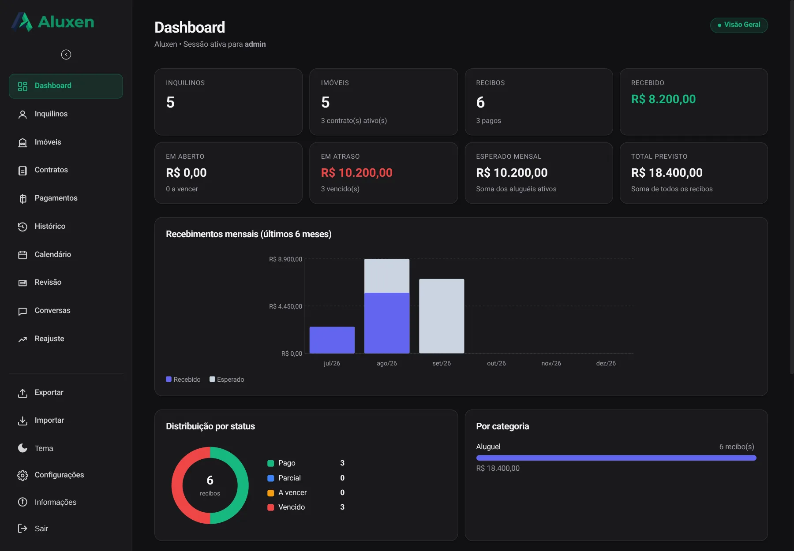

# Aluxen

[](https://github.com/passoz/aluxen/actions/workflows/ci.yml)
[](LICENSE)
[](https://go.dev/)

Gestão de locações imobiliárias em um binário Go. Contratos, recibos, baixa de pagamento, PDFs com
autenticidade por QR Code, portal do locatário e atendimento por WhatsApp. SQLite ou Postgres,
escolhidos pela `DATABASE_URL`.



## O que faz

- **Inquilinos, imóveis e contratos.** Cadastro com validação de CPF, CEP e e-mail, reajuste e
  controle de vigência.
- **Recibos e baixa em lote.** Emissão em PDF, valor por extenso, baixa individual ou em lote e
  histórico de cada alteração.
- **Documentos com autenticidade.** Recibo, contrato e vistoria saem com QR Code e token HMAC. O
  portal público de validação confirma o documento sem expor o restante da base.
- **Área do locatário.** Login por CPF, isolamento por titular e acesso apenas aos próprios
  contratos, recibos e documentos.
- **WhatsApp.** Envio e recebimento pelo WAHA em modo demonstração, ou Cloud API oficial em modo
  cliente. Webhook assinado e mensagens vinculadas ao inquilino.
- **Temporada.** Caução, vistoria de entrada e saída, calendário e comparação de inspeções.
- **Auditoria e operação.** Trilha campo a campo, exportação CSV, backup JSON, logs estruturados e
  healthcheck para container.

## Stack

Go 1.27 com `net/http` e templates embutidos; SQLite (`modernc.org/sqlite`) ou Postgres (`pgx`);
migrações com Goose; SQL gerado por sqlc; PDFs com `go-pdf/fpdf`; QR Code com `skip2/go-qrcode`;
senhas com bcrypt; imagem distroless com um único binário e sem shell.

## Como rodar

Pré-requisitos: Go 1.27 ou Docker.

```bash
# local
export SESSION_SECRET="uma-chave-de-32-bytes-ou-mais"
export SEED_PASSWORD="sua-senha-inicial"
export SEED_DEMO=true          # opcional: popula dados de demonstração
go run ./cmd/app
```

```bash
# container
docker build -t aluxen .
docker run --rm -p 3000:3000 \
  -e SESSION_SECRET="uma-chave-de-32-bytes-ou-mais" \
  -e SEED_PASSWORD="sua-senha-inicial" \
  -v aluxen-data:/data \
  aluxen
```

Abra `http://localhost:3000`. O primeiro login usa `SEED_USERNAME` e `SEED_PASSWORD`, e o app exige
a troca da senha antes de liberar o painel. Sem `SEED_PASSWORD` no primeiro boot, o processo falha.

O `docker-compose.yml` lê o `.env`; copie `.env.example` e preencha `SESSION_SECRET` e
`SEED_PASSWORD` antes de `docker compose up --build`.

## Arquitetura

```text
cmd/app            composition root do binário
cmd/migrate        migrações fora do boot
cmd/provision      provisionamento de uma instância
internal/domain    entidades e regras puras
internal/application casos de uso
internal/infrastructure
  db/sqlite        adapter SQLite + sqlc
  db/postgres      adapter Postgres + sqlc
  web              rotas, templates e estáticos embutidos
  pdf, authz, ai, whatsapp, storage, easypanel
migrations/        Goose
queries/ + schema/ SQL e schema do sqlc
```

A mesma regra de negócio roda nos dois bancos. O CI executa a suíte contra SQLite e Postgres e
mantém um teste de paridade de schema.

## Documentação

- [`docs/manual.md`](docs/manual.md) — manual completo, telas, variáveis e operação.
- [`docs/API.md`](docs/API.md) — rotas HTTP.
- [`docs/ARQUITETURA-GO.md`](docs/ARQUITETURA-GO.md) — arquitetura do port Go.
- [`docs/OPERACAO-GO.md`](docs/OPERACAO-GO.md) — operação e diagnóstico.
- [`docs/GUIA-DESENVOLVEDOR.md`](docs/GUIA-DESENVOLVEDOR.md) — desenvolvimento e testes.
- [`docs/PRIVACIDADE.md`](docs/PRIVACIDADE.md) — tratamento de dados.

## Segurança

Uma instância atende um locador. Não há multiusuário nem multitenancy. Use HTTPS e mantenha o
`SESSION_SECRET` fora do repositório. O `.env.example` não contém segredo real.

Para reportar uma vulnerabilidade, veja [`SECURITY.md`](SECURITY.md).

## Licença

AGPL-3.0. Veja [`LICENSE`](LICENSE).
